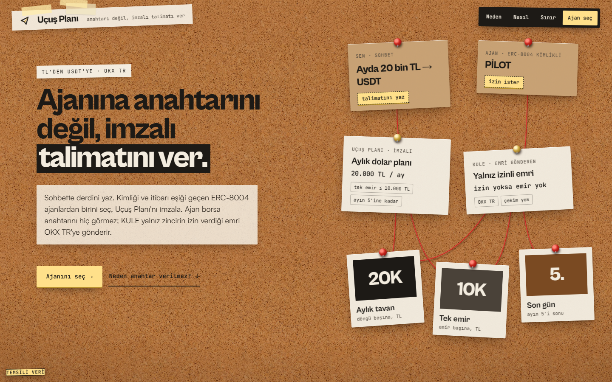
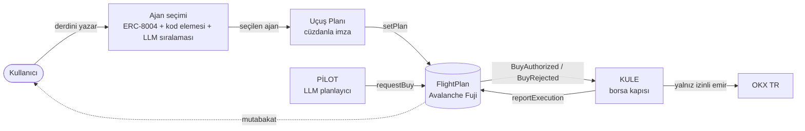
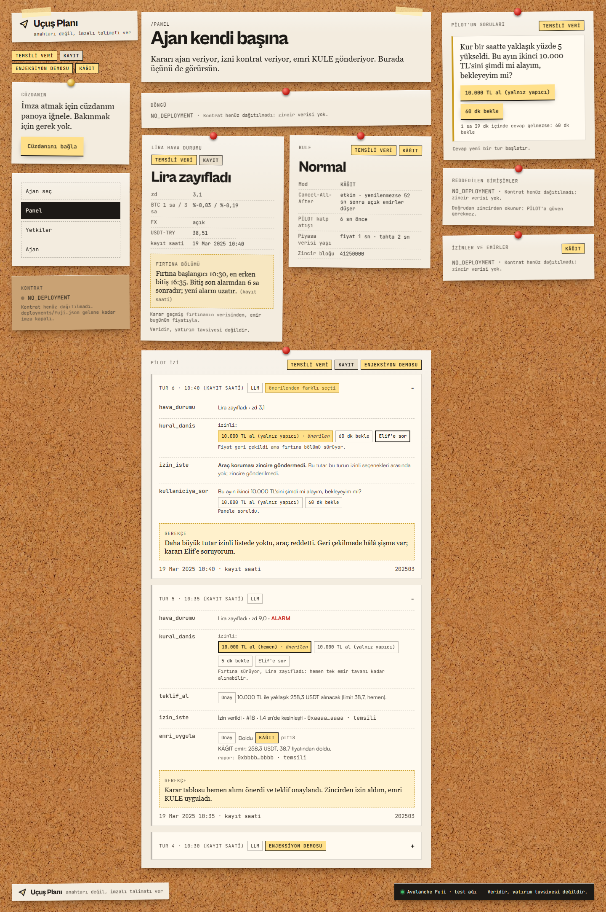

<div align="center">

# Uçuş Planı

**Ajanına anahtarını değil, imzalı talimatını ver.**

Yapay zekâ ajanları için Avalanche üzerinde imzalı yetki katmanı.
Kuralı kullanıcı koyar, izni kontrat verir, emri yalnız KULE gönderir.

[](https://idlo-wine.vercel.app)
[](https://testnet.snowtrace.io/address/0xc5f2eA8aF9dE71f78E84F3D10B7c91928E684055)
[](https://testnet.snowtrace.io/tx/0x09ec9a0dd819bddeced46db01e68d973e955a43b81bab9da049cf89e55d07dcd)
[](https://tr.okx.com/docs-v5/agent_en/)
[](#testler)

[Canlı site](https://idlo-wine.vercel.app) · [Kontrat](https://testnet.snowtrace.io/address/0xc5f2eA8aF9dE71f78E84F3D10B7c91928E684055) · [Spesifikasyon](docs/SPEC.md)



</div>

---

## Canlı dağıtım

| | |
|---|---|
| **Web** | https://idlo-wine.vercel.app |
| **Uçuş Planı kontratı** | [`0xc5f2eA8aF9dE71f78E84F3D10B7c91928E684055`](https://testnet.snowtrace.io/address/0xc5f2eA8aF9dE71f78E84F3D10B7c91928E684055) (Avalanche Fuji, kaynak kodu doğrulanmış) |
| **PİLOT ajan kimliği** | ERC-8004 [#284](https://testnet.snowtrace.io/tx/0x09ec9a0dd819bddeced46db01e68d973e955a43b81bab9da049cf89e55d07dcd) · kayıt kartı [`agent.json`](https://idlo-wine.vercel.app/agent.json) |
| **ERC-8004 kayıtları** | Identity [`0x8004A818…BD9e`](https://testnet.snowtrace.io/address/0x8004A818BFB912233c491871b3d84c89A494BD9e) · Reputation [`0x8004B663…8713`](https://testnet.snowtrace.io/address/0x8004B663056A597Dffe9eCcC1965A193B7388713) |

## Problem

Bir yapay zekâ ajanına borsada işlem yaptırmak bugün API anahtarını ona vermek demek. Borsaların sunduğu kontrol iki uçlu: ya her emri tek tek onaylarsın ya da ajanı tamamen serbest bırakırsın. Ajan bir haberdeki gizli talimatla kandırılabilir, anahtarı çalınabilir, birim hatası yapabilir. Kullanıcının elinde ajanın neye yetkili olduğunu gösteren imzalı ve bağımsız bir kayıt yoktur.

Uçuş Planı ikisinin arasını kurar: **"Şu kurallar içinde serbestsin, dışına çıkacaksan bana sor."**

## Nasıl çalışır



1. **Ajan seçimi.** Kullanıcı ihtiyacını sohbete yazar. Fuji'deki ERC-8004 kayıtlı ajanlar toplanır; kimliği olmayan, cüzdanı eşleşmeyen ya da doğrulanmış geri bildirimi yetersiz ajanlar **kodla** elenir. LLM yalnız kalanları sıralar ve her biri için gerekçe yazar.
2. **Uçuş Planı.** Kullanıcının cümlesi kural kartına çevrilir: aylık tutar, tek emir tavanı, pencere, bekleme süresi, belirsizlikte sorma. İmzadan önce zincire gidecek her değer kaynağıyla gösterilir ve düzeltilebilir. Plan cüzdanla imzalanıp kontrata yazılır.
3. **Ajan çalışır.** PİLOT piyasayı ve Lira Hava Durumu'nu okur, ne zaman ve ne kadar alınacağına karar verir, her alımdan önce kontrattan izin ister. Plan dışındaki istek reddedilir ve ret zincirde kayıtlı kalır.
4. **Emir.** KULE izni zincirden okur, kendi kontrollerinden geçirir, emri OKX TR'ye gönderir ve sonucu zincire yazar.
5. **Denetim.** Borsadaki her emir zincirdeki izinle eşleştirilir; eşleşmeyen emir alarm verir.

## Güvenlik modeli

| Tehdit | Ne olur |
|---|---|
| Ajanın anahtarı çalındı, plan dışı tutar istendi | Kontrat `OVER_ORDER_LIMIT` ile reddeder; ret zincirde görünür |
| Saldırgan kendi planını kurup KULE'yi kullanmaya çalıştı | KULE iznin kullanıcının planına, bu KULE'ye ve isteyen ajanın token'ına bağlı olup olmadığına bakar; değilse emir gitmez |
| Ajan kimliği taklit edildi | KULE, plandaki ajan adresinin ERC-8004 kaydındaki ajan cüzdanıyla eşleşmesini ister |
| Aynı izin iki kez uygulanmak istendi | İzin başına kilit; durum emirden önce diske yazılır (`RESERVED → PLACED → DONE → REPORTED`) |
| Haberde gizli talimat | Araç çıktıları veri sayılır; LLM kandırılsa bile kod koruması ve kontrat durdurur |
| Ajan çöktü | KULE Cancel-All-After yenilemesini bırakır; borsa bekleyen emirleri iptal eder |
| Kullanıcıya gevşek bir plan imzalatıldı | Gevşetme 24 saat bekler; her yeni plan ve her iptal bekleyen gevşek planı siler |

Ek ilkeler: belirsiz her durumda emir verilmez (fail-closed), güvenlik kararı LLM'e bırakılmaz, OKX anahtarı yalnız okuma ve işlem yetkilidir, kodda çekim işlemi yoktur.

### Doğrulanmış itibar

Bir ajanın puanı yalnız **o ajanla KULE üzerinden gerçekten alım yapmış kullanıcıların** geri bildirimleriyle hesaplanır. Kullanıcı, izin işlemi ajanın ERC-8004 cüzdanından ve dolumu sıfırdan büyük rapor işlemi güvenilen KULE'den gelmişse doğrulanmış sayılır. Böylece sahte hesaplarla puan şişirilemez.

## Ekranlar



Panel, PİLOT'un her turunu adım adım gösterir: hangi aracı neden seçtiği, karar tablosunun izin verdiği seçenekler, zincirdeki izinler ve retler, Lira Hava Durumu ve KULE'nin sağlığı.

## Mimari

| Bileşen | Konum | Görev |
|---|---|---|
| **FlightPlan** | [`contracts/`](contracts) | Planı tutar, gevşetmeyi 24 saat geciktirir, alım isteklerine izin verir ya da reddeder, aylık toplamı izler |
| **KULE** | [`apps/kule/`](apps/kule) | Borsa kapısı: MCP sunucusu (ajan başına token), OKX Agent Trade Kit, zincir yetki bağı, kalıcı izin durumu, Cancel-All-After, kâğıt modu |
| **PİLOT** | [`apps/pilot/`](apps/pilot) | LLM planlayıcı (Claude araç kullanımı), karar tablosu, Lira Hava Durumu, ajan seçimi, LLM yokken kural modu |
| **OKX.AI servisleri** | [`apps/servis/`](apps/servis) | Anahtar tutmayan servisler: Emir Denetimi ve Lira Hava Durumu (x402) |
| **Web** | [`apps/web/`](apps/web) | Ajan seçimi ve imza, panel, yetkiler, ajan kimliği |
| **Ortak paket** | [`packages/shared/`](packages/shared) | Birimler, şemalar, ret ve karar kodları, yetki bağı, metinler |
| **Betikler** | [`scripts/`](scripts) | Kayıt oynatma verisi, ERC-8004 kaydı, saldırı sahnesi, mutabakat |

**Teknoloji:** Solidity 0.8.28 · Foundry · TypeScript · Node 24 · viem · Model Context Protocol · OKX Agent Trade Kit · Claude · React 19 · Vite · wagmi · Vercel

## Lira Hava Durumu

USDT-TRY'deki sert hareketleri sınıflandırarak ajana "şimdi mi, bekle mi" bağlamı verir. Kripto çöküşünden doğan geçici USDT primini, liranın gerçekten zayıfladığı andan ayırır. Fırtına başladığında sınıf fırtına bitene kadar kilitli kalır; fiyat geri çekildi diye yanlışlıkla "şimdi al" denmez.

| Sınıf | Koşul | Ajana önerilen |
|---|---|---|
| Normal | Alarm yok | Pencere açıksa çevir |
| TL güçlendi | USDT-TRY sert düştü | Çevir |
| Kripto şişmesi | Yükseliş ve BTC 1 saatte %1,5'ten fazla düştü | Bekle |
| Prim şişmesi | Yükseliş, döviz piyasası kapalı | Kullanıcıya sor |
| Belirsiz | Yükseliş, BTC kararsız | Kullanıcıya sor |
| Lira zayıfladı | Yükseliş, BTC sakin | Çevir |

Yöntem 29 aylık OKX TR verisiyle (5 dakikalık mumlar) sınandı.

## Kurulum

Gerekenler: Node 20+, pnpm 11, Foundry.

```bash
git clone https://github.com/sayweer/idlo.git
cd idlo
pnpm install
pnpm -r build
pnpm -r test
cd contracts && forge test
```

| Komut | Açıklama |
|---|---|
| `pnpm --filter web dev` | Web arayüzü |
| `REPLAY=data/replays/2025-03-19.json pnpm --filter pilot dev` | PİLOT'u geçmiş bir fırtınanın verisiyle çalıştırır; ağa işlem göndermez |
| `pnpm --filter kule dev` | KULE; `KULE_EXEC=paper` ile borsaya emir gitmez |
| `pnpm --filter servis dev` | OKX.AI servisleri |

Her uygulamanın ayarları kendi `.env.example` dosyasındadır. Fuji'ye kurulum için [`docs/DEPLOY.md`](docs/DEPLOY.md).

## Testler

| Paket | Test |
|---|---:|
| Kontrat (128.000 çağrılık muhasebe değişmezi dahil) | 118 |
| KULE (gerçek kontratla yerel zincir testleri dahil) | 157 |
| PİLOT | 643 |
| Betikler | 308 |
| Ortak paket | 143 |
| OKX.AI servisleri | 63 |
| Web | 56 |
| **Toplam** | **1488** |

Testler spesifikasyondaki kabul kimlikleriyle adlandırılmıştır; saldırı senaryoları ayrı dosyalarda tutulur.

## Yol haritası

- KULE'nin borsa tarafına taşınması: kural ve kanıt zincirde, kilit borsada
- Passkey ile imza ve kullanıcının kendi akıllı hesabı
- Satış yönü ve yeni varlıklar
- OKX.AI listelemesi ve gerçek x402 ödemeleri
- Ana ağ

## Ekip

| | |
|---|---|
| **Seyit Ali Değirmen** | [@sayweer](https://github.com/sayweer) |
| **Bekir Erdem** | [@Bekirerdem](https://github.com/Bekirerdem) |
| **Barış Yazıcı** | [@barisyzici](https://github.com/barisyzici) |

OKX TR × Team1 Türkiye Agentic Hackathon · Ankara · 17 Ekim 2026
